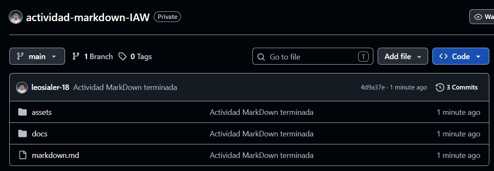

# Actividad: Desarrollo de MarkDown

```#Información
Asignatura: Implementación de Aplicaciones Web
Nombre: Leonardo Sialer Gonzales
Fecha: 23 - 10 - 2026
```
## 1. Objetivo del ejercicio
Aprender a estructurar documentación técnica utilizando sintaxis `Markdown`, comprender la diferencia entre rutas relativas (imágenes locales) y enlaces externos, y publicar el resultado en un repositorio
público de `GitHub`.

## 2. Estructura del repositorio

```#estructura
actividad-markdown-IAW
├── markdown.md (fichero principal)
├── docs/
|     └── detalles.md (fichero secundario)
└── assets/
      └── captura-repositorio.jpg
      └── ods.png
      └── sostenibilidad.png
```

## 3. Requisitos de contenido (markdown.md)
El documento markdown.md trata sobre un tema con sentido global e incluye los siguientes elementos:
- Título y Subtítulo: Un encabezado principal y al menos un subtítulo.
- Formato de Texto: Un párrafo con negrita, cursiva y código en línea.
- Bloque de Código: Un bloque de código multilínea.
- Listas: Una lista ordenada y una lista desordenada.
- Enlaces Funcionales: Un enlace a una URL externa y un enlace relativo hacia `docs/detalles.md`.
- Imagen Local (Assets): Al menos una imagen subida a la carpeta `/assets` e insertada mediante ruta relativa.

- Imagen Externa (Wikimedia): Imagen de `Wikimedia Commons` sobre el instituto enlazada por su URL directa.
- Tabla: Tabla en `Markdown` con al menos 3 columnas y 2 filas con información.

## 4. Forma de entrega
Sube todo el proyecto a un repositorio público de `GitHub`. En la tarea de la plataforma entrega únicamente el enlace directo al repositorio (público) y una captura de pantalla donde se vea el documento visualizado en `GitHub`.


<small>En la captura sale el repositorio privado pero al entregarlo ya será público.</small>