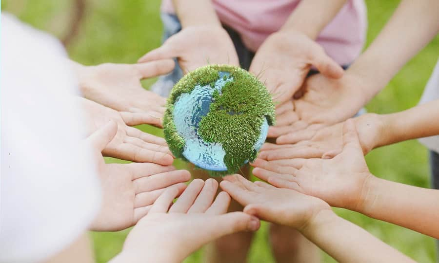
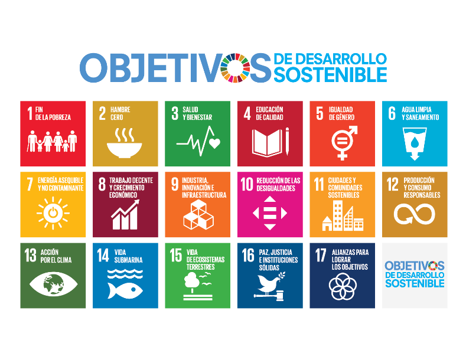

# Medio ambiente y sostenibilidad

## Índice

* [Tema: Medio Ambiente y sostenibilidad](#tema-medio-ambiente-y-sostenibilidad)

* [Medio Ambiente](#medio-ambiente)

* [Sostenibilidad](#sostenibilidad)

* [Desarrollo Sostenible](#desarrollo-sostenible)

* [Huella Ecológica](#huella-ecológica)

* [Gestión Ambiental](#gestión-ambiental)

* [Objetivos de Desarrollo Sostenible (ODS)](#objetivos-de-desarrollo-sostenible-ods)

* [Economía circular](#economía-circular)
    * [Principios de la economía circular](#principios-de-la-economía-circular)
    * [Ciclos de la economía circular](#ciclos-de-la-economía-circular)
    * [Beneficios de la economía circular](#beneficios-de-la-economía-circular)
    * [Diferencias principales entre la economía lineal y circular](#diferencias-principales-entre-la-economía-lineal-y-circular)
* [Referencias](#referencias)
* [Otros](#otros)

<small> Los [detalles del proyecto](/docs/detalles.md) también se encuentra en [Otros](#otros)</small>

## Medio Ambiente
Según las **Naciones Unidas** el medio ambiente es el **conjunto de componentes físicos, químicos, biológicos y sociales con capacidad de causar efectos sobre los seres vivos y las actividades humanas.**

Desde el punto de vista científico, el medio es el entorno en el que se desarrolla un sistema. Según su intercambio de materia y energía, los sistemas se clasifican en:

|Sistemas|Abiertos|Cerrados|Aislados|
|--|--------|--------|--------|
|Intercambio de Materia|Si|No|No|
|Intercambio de Enegía|Si|Si|No|
|Relación con el entorno|Dependencia absoluta del exterior. Si se interrumpe el flujo de entrada o salida, el sistema se desestabiliza y colapsa|Es autosuficiente a nivel material, pero su temperatura y estado interno varían según las condiciones energéticas del exterior|En la realidad no existen fronteras perfectas, por lo que los sistemas aislados reales solo mantienen esta condición por tiempo limitado|
|Ejemplos|Un ser vivo (absorbe oxígeno/alimentos, exhala CO₂ y disipa calor) o un ecosistema (bosque, océano)|Un reloj de cuerda (no cambia su masa, pero recibe y disipa energía cinética/térmica) o el planeta Tierra (intercambio térmico con el Sol, masa casi constante)|Un termo sellado (mantiene la temperatura y el líquido dentro por unas horas)|

### Sostenibilidad
La sostenibilidad es la **capacidad de un sistema para mantenerse estable** a lo largo del tiempo sin perder su equilibrio.

Para conseguirla, es necesario utilizar los recursos de manera responsable, evitar el despilfarro y respetar los límites naturales. La sostenibilidad no consiste únicamente en crecer, sino en mantener un equilibrio entre los recursos disponibles y las necesidades de la sociedad.

### Desarrollo sostenible

El desarrollo sostenible busca satisfacer las necesidades actuales sin comprometer la capacidad de las generaciones futuras para satisfacer las suyas. Esta definición fue establecida en 1987 por el `Informe Brundtland` de las Naciones Unidas.

Se basa en tres dimensiones fundamentales:
- _**Ambiental:**_ proteger los ecosistemas y conservar los recursos naturales.
- _**Social:**_ garantizar la igualdad, el bienestar y unas condiciones de vida dignas.
- _**Económica:**_ desarrollar una economía viable que utilice los recursos de forma responsable.

Estas tres dimensiones deben mantenerse en equilibrio para alcanzar un desarrollo sostenible.

Entre los principales problemas ambientales destacan el agotamiento de los recursos naturales, la contaminación, el cambio climático, la pérdida de biodiversidad y el crecimiento del consumo.

### Huella ecológica
La huella ecológica es un **indicador que mide el impacto de una población sobre el medio ambiente**, teniendo en cuenta los recursos que consume y los residuos que genera.

Se expresa como la superficie de territorio necesaria para producir los recursos utilizados y absorber los residuos generados por una población.

Para calcularla se consideran aspectos como:
- El consumo de materiales y energía.
- La producción y absorción de residuos.
- El espacio ocupado por viviendas, infraestructuras y otras actividades humanas.
Este indicador permite comparar el impacto ambiental de diferentes poblaciones y conocer si su consumo de recursos es sostenible.

### Gestión ambiental
La gestión ambiental comprende las **actuaciones destinadas a proteger el medio ambiente**, cumplir la legislación y reducir los impactos negativos de las actividades humanas y empresariales.

Las empresas pueden utilizar un **Sistema de Gestión Ambiental (SGA)** para organizar y controlar sus actividades ambientales, establecer objetivos y mejorar continuamente su comportamiento.

Los principales principios de la gestión ambiental son:
- **Quien contamina paga:** el responsable de la contaminación debe asumir los costes del daño causado.
- **Desarrollo sostenible:** utilizar los recursos sin comprometer el futuro.
- **Tecnologías limpias:** emplear procesos que reduzcan la contaminación y el consumo de recursos.
- **Acceso a la información ambiental:** facilitar información sobre el impacto ambiental a consumidores y usuarios.

Una buena gestión ambiental permite reducir costes de materias primas, agua y energía, disminuir los residuos y mejorar la competitividad de las empresas.

## Objetivos de Desarrollo Sostenible (ODS)
Los **Objetivos de Desarrollo Sostenible** forman parte de la `Agenda 2030` de las Naciones Unidas, aprobada en 2015. Su finalidad es **combatir la pobreza, reducir las desigualdades y proteger el planeta**.

La Agenda 2030 establece 17 objetivos y 169 metas que deben abordarse de manera conjunta, teniendo en cuenta sus relaciones entre sí.

Los **17 ODS** son:
1. Fin de la pobreza.
2. Hambre cero.
3. Salud y bienestar.
4. Educación de calidad.
5. Igualdad de género.
6. Agua limpia y saneamiento.
7. Energía asequible y no contaminante.
8. Trabajo decente y crecimiento económico.
9. Industria, innovación e infraestructura.
10. Reducción de las desigualdades.
11. Ciudades y comunidades sostenibles.
12. Producción y consumo responsables.
13. Acción por el clima.
14. Vida submarina.
15. Vida de ecosistemas terrestres.
16. Paz, justicia e instituciones sólidas.
17. Alianzas para lograr los objetivos.

Estos objetivos promueven un modelo de desarrollo que combine el bienestar social, el progreso económico y la protección ambiental.

## Economía circular
La economía circular es un modelo económico que busca **reducir los residuos y aprovechar los materiales durante el mayor tiempo posible**, sustituyendo el modelo tradicional de producir, consumir y tirar.

Su objetivo es **convertir los residuos en recursos, reducir el consumo de materias primas y energía y disminuir el impacto ambiental**.

### Principios de la economía circular
- **Ecodiseño:** diseñar productos teniendo en cuenta su impacto ambiental durante todo su ciclo de vida.
- **Segundo uso:** volver a utilizar productos que ya no necesita su propietario inicial.
- **Reutilización:** aprovechar productos o componentes para nuevos usos.
- **Reparación:** arreglar productos para alargar su vida útil.
- **Reciclaje:** transformar residuos en materiales que puedan utilizarse de nuevo.
- **Valorización energética:** aprovechar la energía de los residuos que no pueden reciclarse.
- **Consumo responsable:** comprar y utilizar únicamente lo necesario.

### Ciclos de la economía circular
La economía circular distingue dos tipos de ciclos:
- _Ciclo biológico:_ los materiales naturales, como los alimentos o la madera, pueden regresar a la naturaleza mediante procesos como el compostaje.

- _Ciclo técnico:_ los productos y materiales se mantienen en uso mediante la reutilización, la reparación, la remanufactura y el reciclaje.

### Beneficios de la economía circular
La economía circular permite **reducir el consumo de recursos naturales, disminuir los residuos, ahorrar energía y reducir la contaminación.** Además, puede generar empleo, impulsar la innovación y fortalecer las economías locales.

A diferencia de la economía lineal, que sigue el modelo de extraer, producir, consumir y desechar, la economía circular intenta mantener los materiales y productos en circulación durante el mayor tiempo posible.

### Diferencias principales entre la economía lineal y circular

||Economía Lineal|Economía Circular|
| --- | --- |---|
|Enfoque de recursos|Extracción continua sin preocupación|Maximizar la eficiencia: `Reutilizar, reciclar y regenerar`|
|Ciclo de vida del producto|Corto y terminan en residuos|Extendido, con múltiples usos, reparaciones y reciclajes|
|Gestión de residuos|Genera en gran cantidad y termina en vertederos o incinerados|Intenta reintroducirlos en el ciclo productivo, minimizando la cantidad de desechos|
|Impacto ambiental|Aumentan la presión ambiental por la explotación continua|Reduce la presión ambiental al optimizar los recursos|

## Referencias
- [Web de la Organización de las Naciones Unidas](https://www.un.org/es)

- [Desarrollo sostenible y acción climática (ONU)](https://www.un.org/es/our-work/support-sustainable-development-and-climate-action)

- [Agenda y Obejtivos de Desarrollo Sostenible](https://www.un.org/sustainabledevelopment/es/development-agenda/)

- [Economía Circular](https://www.esade.edu/beyond/es/que-es-economia-circular/)

- [Libro de Apoyo: Vol. 3.1 Módulo profesional de sostenibilidad aplicada al sistema productivo](https://estaticos.naturgy.com/fundacion/modulo-profesional-sostenibilidad-aplicada-sector-productivo-v1/12/)

## Otros

Consultar los [detalles del proyecto](docs/detalles.md).

